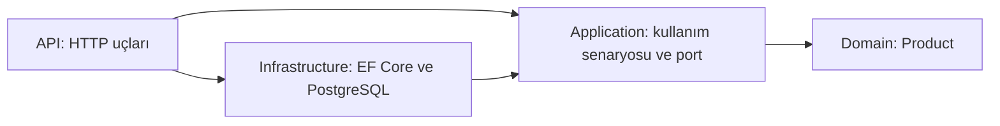

# Idempotency-Key öğrenme projesi

.NET 10 · ASP.NET Core · EF Core 10 · PostgreSQL 17

Bir ürün oluşturma isteği sunucuda başarılı olabilir, fakat ağ kesilmesi nedeniyle istemci yanıtı alamayabilir. İstemci **aynı işlemi aynı anahtarla** tekrar gönderirse API yeni ürün oluşturmaz; ilk yanıtın gövdesini, durum kodunu ve Location başlığını döndürür. Yeni bir alışveriş/işlem için **yeni anahtar** üretilir. Aynı ürün verisini farklı anahtarla göndermek yeni ürün oluşturur; bu mekanizma ürün adı benzersizliği sağlamaz.

## Onion / Clean katmanları



- `Domain/Product.cs`: bağımsız ürün modeli.
- `Application/Products.cs`: doğrulama, CreateProduct kullanım senaryosu ve IProductStore portu. EF Core veya ASP.NET referansı yoktur.
- `Infrastructure/ProductStore.cs`: portun EF Core implementasyonu; transaction, PostgreSQL kilidi ve kalıcı yanıt kaydı.
- `Api/Program.cs`: bağımlılıkların bağlandığı composition root ve HTTP uçları.

Dosyalar `src/Idempotency.*` klasörlerindedir. Okuma sırası: Product → Products → ProductStore → Program.

## Çalıştırma

Gereksinimler: .NET 10 SDK, Docker + Compose. Entegrasyon testi için Python 3.

```bash
cd /workspace/idempotencyKey
# SDK bu bulut ortamında /workspace/.dotnet altında kurulu.
export PATH="/workspace/.dotnet:$PATH"
export DOTNET_CLI_HOME=/workspace/.dotnet-home
export NUGET_PACKAGES=/workspace/.nuget/packages
dotnet restore --locked-mode
dotnet build --no-restore
bash scripts/start.sh
```

Kendi bilgisayarında .NET SDK PATH içindeyse `dotnet restore`, `docker compose up -d --wait postgres` komutlarından sonra aşağıdaki gibi doğrudan da çalıştırabilirsin:

```bash
ConnectionStrings__Postgres='Host=localhost;Port=5432;Database=idempotency;Username=learning;Password=local-learning-only' \
ASPNETCORE_URLS=http://127.0.0.1:5080 \
dotnet run --project src/Idempotency.Api
```

Compose parolası yalnızca yerel eğitim içindir; PostgreSQL portu loopback'e bağlıdır. Harici DB için bağlantı bilgisini ortam değişkeninden ver. API açılışta `EnsureCreatedAsync` ile **boş veritabanının** tablolarını oluşturur. Bu bir migration stratejisi değildir; şema değişiklikleri ve production dağıtımları için EF Core migration eklenmelidir. Mevcut başka tabloları olan bir veritabanı yerine bu projeye ayrılmış DB kullan.

## Deney: aynı isteği tekrar gönder

```bash
curl -i http://127.0.0.1:5080/products \
  -H 'Content-Type: application/json' \
  -H 'Idempotency-Key: product-demo-001' \
  -d '{"name":"Kalem","price":25.50}'
```

1. İlk istekte `201 Created`, `Idempotency-Replayed: false` ve yeni ürün kimliği gelir.
2. Komutu aynen tekrar çalıştır: yine `201`, aynı gövde ve Location; `Idempotency-Replayed: true` gelir. Tek ürün vardır.
3. Anahtarı değiştirmeden fiyatı `30` yap: `409 Conflict` gelir.
4. Anahtarı `product-demo-002` yap: yeni ürün oluşturulur.
5. Başlığı kaldır: `400 Bad Request` gelir.
6. Dönen `Location` yoluna GET göndererek ürünü oku (`GET /products/{id}`).

Fiyat pozitif, en fazla iki ondalık basamaklı; isim en fazla 200 karakter olmalıdır. İsim başı/sonu boşluklar temizlenir. Gövde özeti doğrulanmış ve normalize edilmiş veriden üretildiği için JSON alan sırası, boşlukları ve `25.5` / `25.50` gösterimleri farklı işlem sayılmaz.

## İdempotency nasıl çalışıyor?

`POST:/products:` + anahtar işlem kimliğidir. Normalize edilmiş istek SHA-256 ile özetlenir. Transaction açılır ve bu anahtar için `pg_advisory_xact_lock` alınır. Aynı anahtarla gelen başka istek kilidin bırakılmasını bekler; farklı API process'leri de aynı PostgreSQL üzerinden koordinasyon sağlar.

Kayıt varsa özet karşılaştırılır: aynıysa saklanan yanıt döner, farklıysa 409 verilir. Kayıt yoksa ürün ve yanıt **aynı transaction** içinde yazılıp commit edilir. Hata olursa ikisi de rollback olur; transaction kilidi otomatik bırakılır. Commit sonrasında yanıt kaybolsa bile tekrar istek kayıtlı yanıtı alır. Idempotency kayıt tablosunun primary key'i de tam kapsamlı anahtardır; kilit özetinin olası çakışması yanlış yanıt döndürmez, yalnızca beklemeye yol açar.

Örnek basitliği için kayıtlar süresiz tutulur, kimlik doğrulama ve rate limit yoktur. Gerçek sistemde anahtarı tenant/kullanıcı + endpoint kapsamında tut; saklama süresini ve temizleme politikasını belirle. Anahtar silinirse tekrar istek yeni işlem oluşturabilir. Yalnızca başarılı ürün oluşturma yanıtları saklanır; doğrulama hataları anahtarı tüketmez. Bu transaction yaklaşımı yalnızca aynı DB'deki yan etkileri kapsar; e-posta/ödeme gibi harici işlemler için outbox ve sağlayıcının idempotency desteği gerekir. Replay başlığı farklıdır; saklanan durum, gövde ve Location aynıdır.

## Doğrulama

API açıkken başka terminalde:

```bash
python3 tests/smoke.py
```

Test gerçek PostgreSQL kullanan API'ye istek gönderir. Eksik anahtar, geçersiz veri, ilk oluşturma, tekrar yanıtı, semantik olarak aynı gövde, GET, farklı gövdeyle çakışma, yeni anahtar ve 12 paralel isteğin tek oluşturmayla sonuçlanması kontrol edilir. İki farklı gövdenin aynı anahtar için yarışması da test edilir. Her çalıştırma yeni anahtarlar üretir ve test ürünleri DB'de kalır.

API'yi Ctrl+C ile durdur. `docker compose stop` veriyi korur. **`docker compose down -v` yerel veriyi siler**; yalnızca sıfırlamak istediğinde kullan.
